# Projeto - Cidades ESG Inteligentes | HydroGuard

Sistema de monitoramento de consumo de água, cadastro de medidores, alertas de possíveis vazamentos e indicadores ESG. API ASP.NET Core 8, frontend HTML/CSS/JavaScript e SQL Server, com pipeline CI/CD completo (GitHub Actions), containerização com Docker e deploy automatizado em **staging** e **produção**.

## Como executar localmente com Docker

Pré-requisitos: Docker Engine/Docker Desktop com containers Linux e Docker Compose v2.24 ou superior; SDK .NET 8 para testes/smoke; Python 3.10+ apenas para a geração opcional do `.env`; host x86-64 com cerca de 4 GB de RAM livres para uma stack.

1. Clone o repositório e abra um terminal na pasta do projeto.
2. Gere a configuração local com senhas aleatórias (o script recusa sobrescrever um `.env` existente):

```bash
python3 scripts/setup_env.py
```

No Windows, use `python` se `python3` não estiver disponível. Alternativa manual: copie `.env.example` para `.env` e substitua TODOS os valores com `SUBSTITUA`. Use senhas de pelo menos 12 caracteres e chave JWT aleatória de pelo menos 32 bytes. Evite espaços, aspas, `$` e `;` nas senhas.

3. Suba a stack:

```bash
docker compose -p hydroguard-local config --quiet
docker compose -p hydroguard-local up -d --build --wait --wait-timeout 300
docker compose -p hydroguard-local ps
```

4. Abra a [interface local](http://localhost:5000), o [Swagger](http://localhost:5000/swagger) e o [readiness](http://localhost:5000/healthz).
5. Entre com usuário `admin` e a senha `ADMIN_PASSWORD` do seu `.env`. O ambiente local cria dados demonstrativos. Staging e produção criam somente o admin.

O banco só é acessível pela rede Docker. As migrations são aplicadas no início da API, depois que o SQL Server fica saudável. O health check `/healthz` inclui a conexão com o banco; `/livez` verifica apenas o processo.

```bash
# Parar sem apagar dados
docker compose -p hydroguard-local down
# Diagnóstico local (revise antes de compartilhar)
docker compose -p hydroguard-local logs --tail=100 api sqlserver
```

Não use `down --volumes` em staging/produção: isso apaga os dados. O pipeline usa essa opção somente na stack temporária de CI.

### Executar testes

```bash
dotnet restore HydroGuard.sln
dotnet build HydroGuard.sln -c Release --no-restore
dotnet test tests/HydroGuard.Tests/HydroGuard.Tests.csproj -c Release --no-build --logger "trx;LogFileName=tests.trx" --results-directory TestResults
```

O projeto `HydroGuard.Tests` tem 20 testes (xUnit, WebApplicationFactory e EF InMemory). Como o InMemory não valida SQL nem migrations, o pipeline também sobe um SQL Server real e executa um smoke test HTTP (`tests/HydroGuard.SmokeTests`), que verifica readiness, frontend, Swagger, 401 anônimo, login JWT e rotas da API.

## Pipeline CI/CD

Ferramenta: **GitHub Actions**. Registry: **GitHub Container Registry (GHCR)**. Workflow: `.github/workflows/ci-cd.yml`.

| Etapa | Onde executa | O que valida / realiza |
| --- | --- | --- |
| build-test | Runner GitHub Ubuntu 24.04 | Restore, build Release e 20 testes xUnit, com arquivo TRX e cobertura |
| container | Runner GitHub Ubuntu 24.04 | Build Docker, Compose com SQL Server real, readiness, frontend, Swagger, 401 anônimo, login JWT, medidores e ESG |
| publicação | Mesmo job `container`; somente em `main` | Publica a imagem com a tag do commit e obtém a referência imutável por digest SHA-256 |
| deploy-staging | Runner próprio com label `hydroguard-staging` | Pull da imagem por digest, Compose, smoke test. Não recompila a imagem |
| deploy-production | Runner próprio com label `hydroguard-production` | Executa após o staging aprovado, com exatamente o mesmo digest e o mesmo smoke test |

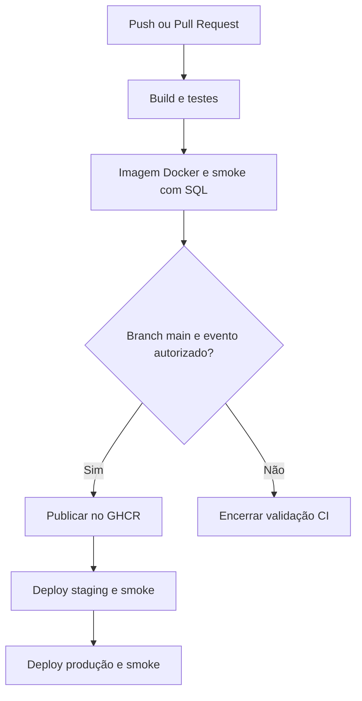

Pull requests executam apenas o CI e não publicam nem fazem deploy. Push em `main` e execução manual em `main` executam o fluxo completo. Uma falha bloqueia as etapas seguintes. A produção é promovida automaticamente após o staging (deployment contínuo, sem aprovação manual).

### Infraestrutura de staging e produção

Os dois ambientes rodam em uma única VM no **Azure**:

| Item | Valor |
| --- | --- |
| Tamanho | Standard D2s v4 (2 vCPU, 8 GiB de memória) |
| Sistema | Ubuntu Server 24.04 LTS, x64 |
| Runners | 2 runners do GitHub instalados como serviço: `runner-staging` (label `hydroguard-staging`) e `runner-production` (label `hydroguard-production`) |
| Isolamento | Projetos Compose distintos (`hydroguard-staging` e `hydroguard-production`), cada um com seus containers, rede, volume e porta |
| Portas | Staging na `5001`, produção na `5000`, ambas publicadas apenas em `127.0.0.1` da VM |
| Acesso para demonstração | Túnel SSH (`ssh -L 5001:127.0.0.1:5001 -L 5000:127.0.0.1:5000 ...`) |

Configuração no GitHub (Settings > Environments), com valores diferentes em cada ambiente:

| Tipo | Nome | staging | production |
| --- | --- | --- | --- |
| Secret | `MSSQL_SA_PASSWORD` | valor próprio | valor próprio |
| Secret | `JWT_KEY` | valor próprio | valor próprio |
| Secret | `ADMIN_PASSWORD` | valor próprio | valor próprio |
| Variable | `API_PORT` | `5001` | `5000` |
| Variable | `APP_URL` | `http://localhost:5001` | `http://localhost:5000` |

Os dois environments aceitam deploy apenas da branch `main`. Nenhuma senha é versionada: tudo vem de GitHub Secrets. A autenticação no GHCR usa o `GITHUB_TOKEN` do próprio workflow.

### Falhas e rollback

Se o smoke de staging falhar, a produção não é promovida. Não há rollback automático: para voltar, execute `scripts/deploy.sh` no host com `API_IMAGE` apontando para o digest anterior e `DEPLOY_ENV` correspondente. Reverter a imagem não reverte migrations, então use apenas versões compatíveis com o schema atual. O modelo usa uma réplica da API por ambiente e pode ter breve indisponibilidade ao recriar o container.

## Containerização

Dockerfile multi-stage: o SDK restaura e publica a aplicação; a imagem final contém só o runtime ASP.NET e o `curl` para o health check, sem SDK nem código-fonte. A restauração precede a cópia do código para aproveitar o cache de camadas. A API roda como usuário não-root `app`, escuta na porta 8080 e recebe os segredos por variáveis de ambiente em runtime. A revisão do commit é incluída na imagem e aparece em `/healthz`.

```dockerfile
# syntax=docker/dockerfile:1
FROM mcr.microsoft.com/dotnet/sdk:8.0 AS build
WORKDIR /source
COPY src/HydroGuard.API/HydroGuard.API.csproj src/HydroGuard.API/
RUN dotnet restore src/HydroGuard.API/HydroGuard.API.csproj
COPY src/HydroGuard.API/ src/HydroGuard.API/
RUN dotnet publish src/HydroGuard.API/HydroGuard.API.csproj -c Release --no-restore -o /app/publish /p:UseAppHost=false

FROM mcr.microsoft.com/dotnet/aspnet:8.0-bookworm-slim AS runtime
USER root
RUN apt-get update && apt-get install -y --no-install-recommends curl && rm -rf /var/lib/apt/lists/*
WORKDIR /app
COPY --from=build --chown=app:app /app/publish .
ARG APP_REVISION=local
ARG APP_SOURCE=
LABEL org.opencontainers.image.revision=$APP_REVISION org.opencontainers.image.source=$APP_SOURCE
ENV ASPNETCORE_URLS=http://+:8080 HydroGuard__Revision=$APP_REVISION
USER app
EXPOSE 8080
HEALTHCHECK --interval=15s --timeout=5s --start-period=60s --retries=10 CMD curl -fsS http://localhost:8080/healthz || exit 1
ENTRYPOINT ["dotnet", "HydroGuard.API.dll"]
```

O `docker-compose.yml` orquestra a API e o SQL Server 2022 Express, com volume persistente, uma rede `frontend` e uma rede `database` interna (`internal: true`). A porta 1433 não é publicada. `depends_on: service_healthy` evita iniciar a API antes de o SQL Server estar pronto, e `up --wait` aguarda também o readiness da API.

Tag da imagem: `ghcr.io/victormiguel35/hydroguard:<commit>`. No deploy, a imagem é referenciada por digest imutável (`ghcr.io/victormiguel35/hydroguard@sha256:...`), e a mesma imagem é promovida de staging para produção.

## Prints do funcionamento

Evidências da execução **#3** do workflow `HydroGuard CI-CD` (commit `53dc7d5`, branch `main`).

### Pipeline

**Runners próprios online (Idle), com os labels de staging e produção:**

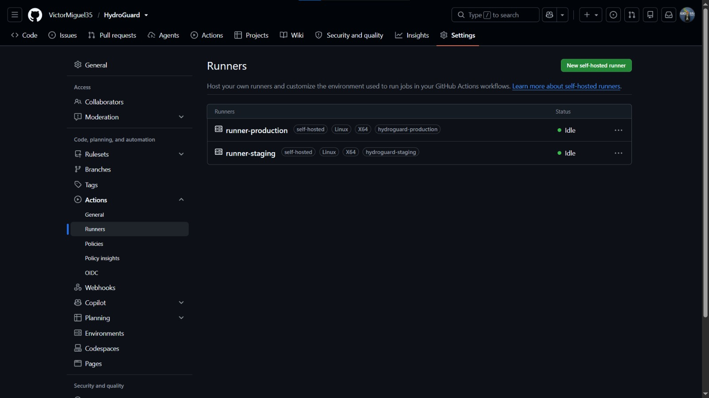

**Execução completa com os 4 jobs aprovados** (build-test 35s, container 2m 3s, deploy-staging 1m 16s, deploy-production 48s; total 4m 56s):

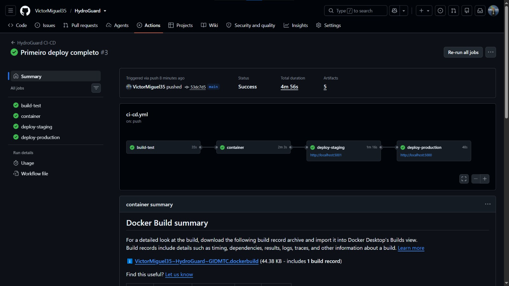

**Testes automatizados: 20 aprovados, 0 falhas:**

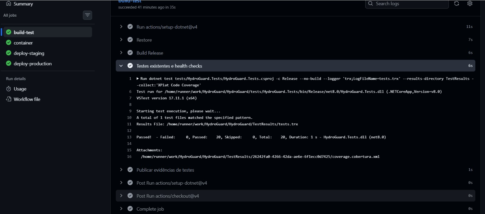

### Staging (porta 5001)

**Dashboard ESG:**

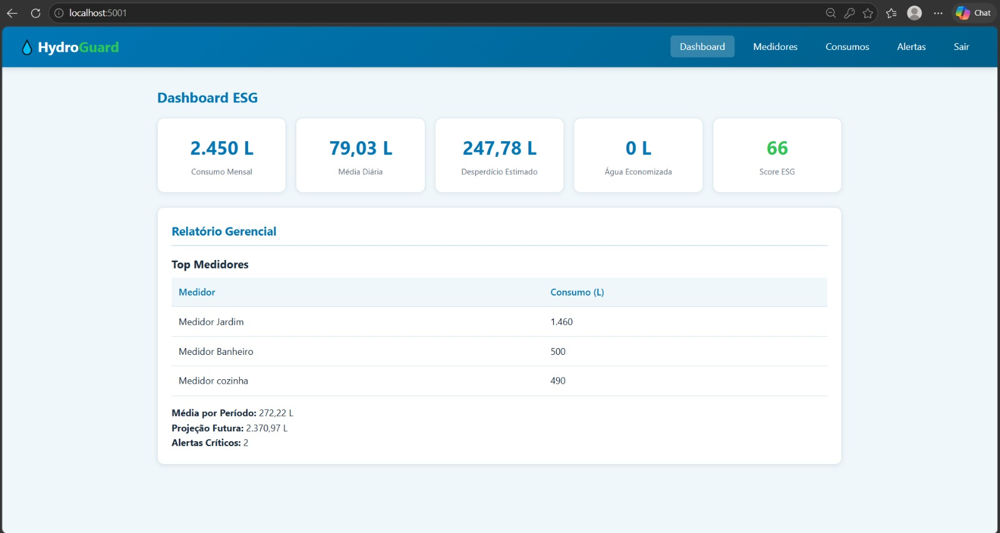

**Medidores cadastrados (seriais `HG-STG-*`):**

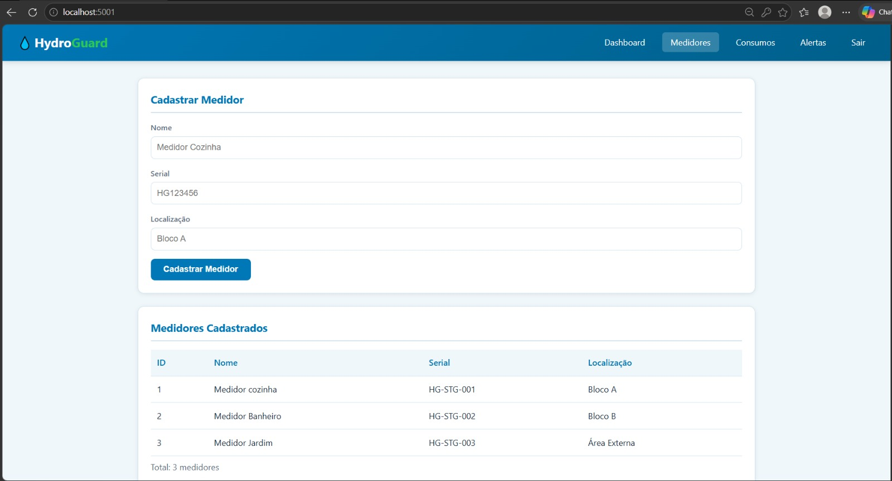

**Histórico de consumos:**

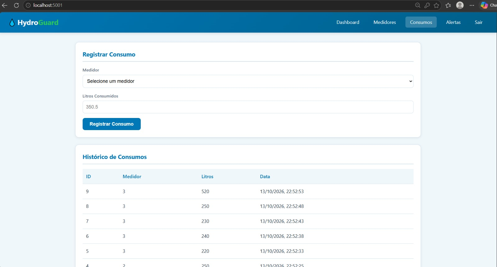

**Alerta de vazamento detectado (severidade Alta):**

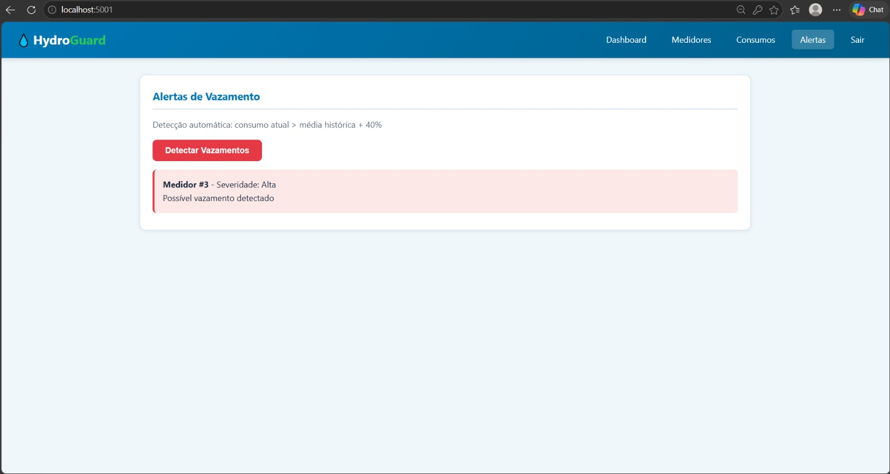

### Produção (porta 5000)

**Dashboard ESG:**

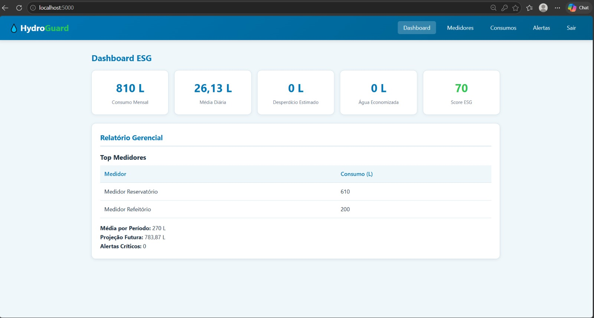

**Medidores cadastrados (seriais `HG-PRD-*`):**

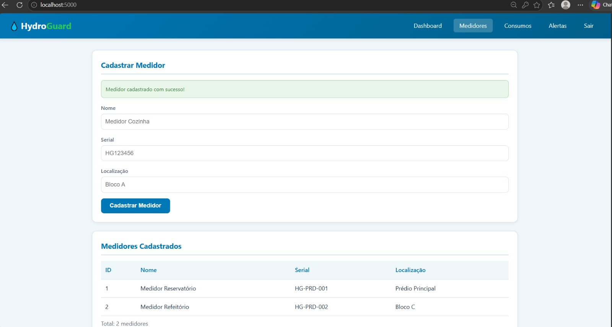

**Histórico de consumos:**

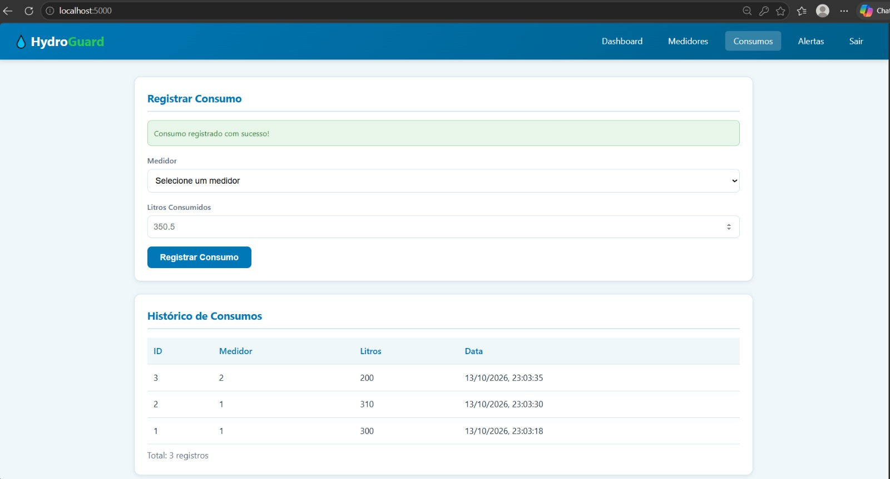

**Detecção de vazamentos sem ocorrências (cenário saudável):**

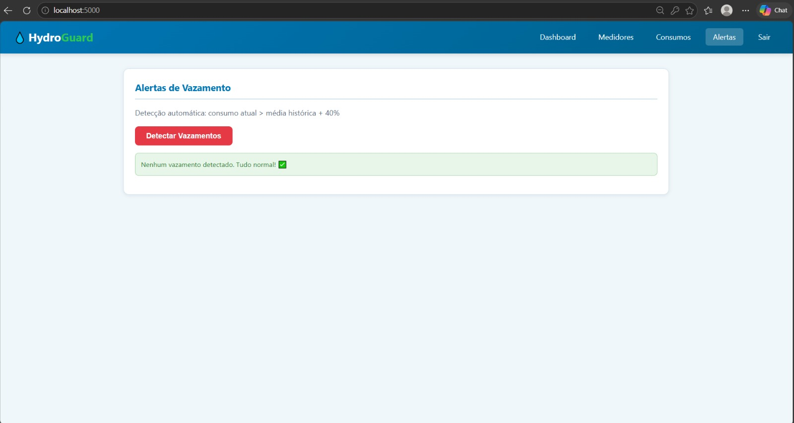

### Containers, redes e volumes na VM

Containers `healthy` nos dois projetos Compose, dois volumes `sqlserver_data` separados, banco sem porta publicada no host, e **o mesmo digest `sha256:c0ba08b5...` da imagem da API nos dois ambientes**, o que comprova a promoção da mesma imagem de staging para produção:

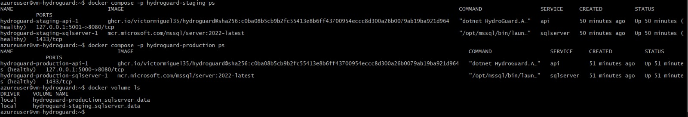

Os medidores cadastrados em staging não aparecem em produção, e vice-versa: cada ambiente tem seu próprio banco.

## Tecnologias utilizadas

- C# e ASP.NET Core 8; Entity Framework Core 8 com migrations.
- SQL Server 2022 Express; BCrypt; autenticação JWT.
- HTML, CSS e JavaScript; Swagger/OpenAPI.
- xUnit, WebApplicationFactory, EF InMemory e Coverlet.
- Docker, Docker Compose v2, GitHub Actions, GitHub Container Registry (GHCR) e runners próprios Linux x64.
- Microsoft Azure (VM Ubuntu 24.04) como host de staging e produção.
- C#/.NET 8 para todos os testes e para o smoke HTTP; Bash para o deploy.
- Python apenas no gerador opcional de `.env`; não é usado pelo pipeline.

## Estrutura do projeto

```text
.
├── Dockerfile
├── docker-compose.yml
├── .env.example
├── HydroGuard.sln
├── .github/workflows/ci-cd.yml
├── scripts/            (deploy.sh, setup_env.py)
├── src/HydroGuard.API/ (API, frontend em wwwroot, migrations)
├── tests/              (HydroGuard.Tests e HydroGuard.SmokeTests)
└── docs/               (documentação técnica e prints)
```

## Desafios encontrados e soluções

| Desafio | Solução |
| --- | --- |
| Os 20 testes falharam na primeira execução do CI: a `Jwt:Key` configurada pela factory de testes chegava ao `Program.cs` vazia, porque `ConfigureAppConfiguration` é aplicado depois da leitura no hosting mínimo | Troca por `builder.UseSetting("Jwt:Key", ...)` na `HydroGuardWebApplicationFactory`, que é aplicada antes do `Program.cs` |
| Tamanho de VM indisponível e cota zero em uma região do Azure (`QuotaExceeded`) | Escolha de uma VM com 2 vCPU e 8 GiB e cota liberada na assinatura |
| Staging e produção sem servidores reais | VM única no Azure com dois runners próprios (labels distintos) e projetos Compose separados |
| Segredos fora do código em um repositório público | GitHub Environments com secrets e variables distintos por ambiente e deploy restrito à branch `main` |
| API iniciando antes do SQL Server | Health check do SQL, `depends_on: service_healthy` e readiness da API com `up --wait` |
| Staging e produção colidindo no mesmo host | Projetos Compose, portas, redes e volumes distintos |
| Ambientes sem URL pública | Portas publicadas só em `127.0.0.1` e acesso por túnel SSH nas demonstrações |

## Checklist de entrega

- [x] Projeto compactado em ZIP com estrutura organizada e código-fonte completo.
- [x] Dockerfile funcional na raiz.
- [x] docker-compose.yml com API, banco, variáveis, volume e redes.
- [x] Pipeline com etapas de build, teste e deploy em dois ambientes.
- [x] README com instruções e prints.
- [x] Build .NET e 20 testes xUnit executados e aprovados.
- [x] Dockerfile/Compose executados com sucesso e imagem publicada no GHCR.
- [x] Deploy realizado e comprovado em staging.
- [x] Deploy realizado e comprovado em produção.
- [x] Documentação técnica com evidências atualizada.

## Referências técnicas

- [GitHub Actions: controle de deployments](https://docs.github.com/en/actions/how-tos/deploy/configure-and-manage-deployments/control-deployments)
- [GitHub: runners próprios](https://docs.github.com/en/actions/how-tos/manage-runners/self-hosted-runners/use-in-a-workflow)
- [GitHub Container Registry](https://docs.github.com/en/packages/working-with-a-github-packages-registry/working-with-the-container-registry)
- [Docker: ordem de inicialização](https://docs.docker.com/compose/how-tos/startup-order/)
- [Microsoft: SQL Server em containers](https://learn.microsoft.com/en-us/sql/linux/quickstart-install-connect-docker?view=sql-server-ver16)
- [Microsoft: testes de integração ASP.NET Core](https://learn.microsoft.com/en-us/aspnet/core/test/integration-tests?view=aspnetcore-8.0)
